# Asan design system

This document records the visual system implemented in `lib/styles/theme.dart` and the shared widgets in `lib/widgets/`. Use it as the reference when updating existing screens or adding new ones. Values below describe the current app; widget parameters can override defaults where noted.

## Palette

Color constants are defined by `AsanColorScheme` in `lib/styles/theme.dart`.

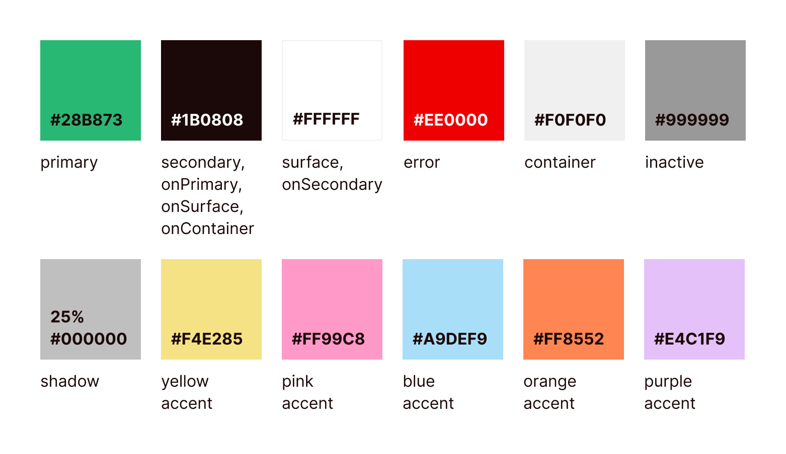

| Role | Hex | Use |
| --- | --- | --- |
| Primary green | `#28B873` | Main actions, selected controls, active icons, and accents |
| Secondary near-black | `#1B0808` | Main text, dark buttons, and outlines |
| Surface white | `#FFFFFF` | Page and card surfaces |
| Container gray | `#F0F0F0` | Input backgrounds, inactive controls, and soft panels |
| Inactive gray | `#999999` | Secondary labels and unselected icons |
| Error red | `#EE0000` | Destructive and error states |
| Yellow | `#F4E285` | Meal-time tag accent |
| Pink | `#FF99C8` | Meal-time tag accent |
| Blue | `#A9DEF9` | Meal-time tag accent |
| Orange | `#FF8552` | Meal-time tag accent |
| Purple | `#E4C1F9` | Meal-time tag accent |
| Shadow | `#40000000` | Translucent black component shadows |

## Type scale

The bundled typeface is **Bricolage Grotesque**, registered as `BricolageGrotesque` in `pubspec.yaml`; regular (400) and bold (700) font files live in `docs/assets/fonts/`.

| Style | Flutter token | Size | Weight | Typical use |
| --- | --- | ---: | --- | --- |
|  | `AsanTextTheme.headlineSmall` | 24 px | Bold (700) | Screen titles and prominent headings |
|  | `AsanTextTheme.bodyMedium` | 16 px | Regular (400) | Paragraphs, form values, and button labels (often bolded) |
|  | `AsanTextTheme.labelSmall` | 12 px | Regular (400) | Captions, compact labels, and text buttons (often bolded) |

All three styles use a line height of 1.4. Components may set a local size or weight for hierarchy.

## Spacing and shape

`AsanSpacing` in `lib/styles/theme.dart` uses a 4 px base unit.

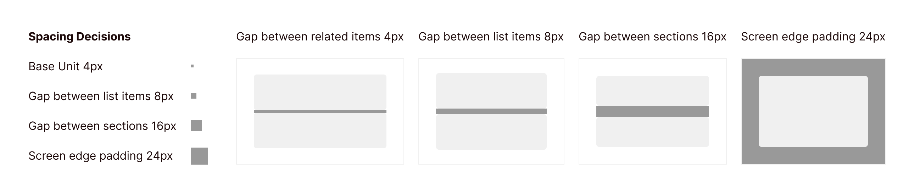

| Token | Value | Typical use |
| --- | ---: | --- |
| `xs` | 4 px | Spacing between related elements inside a list row, plus icon-to-label gaps |
| `sm` | 8 px | Gaps between list rows, compact padding, and field helper spacing |
| `md` | 16 px | Section spacing |
| `lg` | 24 px | Screen-edge padding and roomy form/dialog insets |

Common shapes are 8 px rounded buttons, fields, and cards; 16 px top corners on the bottom navigation and dialogs; 24 px top corners on larger sheets; and pill corners for chips and segmented controls. Use the widget's existing shape when composing shared components.

## Components

Reusable widgets are implemented in `lib/widgets/`.

| Image | Component | File | Constructor parameters | Appears on |
| --- | --- | --- | --- | --- |
|  | `PrimaryButton` | `lib/widgets/buttons.dart` | `label, fontSize, child, icon, iconSize, onPressed, height` | Groceries, Meal Plan, Recipe Details, Recipe Form, Settings, filter and empty states |
|  | `SecondaryButton` | `lib/widgets/buttons.dart` | `label, fontSize, child, icon, iconSize, onPressed, height` | Recipe Details, Recipe Form, Settings |
|  | `AsanOutlinedButton` | `lib/widgets/buttons.dart` | `label, child, onPressed, height` | Filter sheets and Recipe Form |
|  | `AsanTextButton` | `lib/widgets/buttons.dart` | `label, child, onPressed, color, padding` (also `.green`, `.black`, `.red` constructors) | Meal Plan, Recipe Form, Recipes, Recipe Details, Settings, dialogs, and snackbars |
|  | `FilledIconButton` | `lib/widgets/buttons.dart` | `icon (required), onPressed, isActive, badgeCount` | Groceries, Meal Plan, Pantry, Recipes, Search |
|  | `TonalIconButton.square` | `lib/widgets/buttons.dart` | `color (required), icon (required), size (required), onPressed, borderRadius` | Meal Plan, Recipe Form, Groceries, Pantry |
|  | `TonalIconButton.round` | `lib/widgets/buttons.dart` | `icon (required), onPressed, color, backgroundColor, size, borderRadius, showShadow` | Meal Plan, Recipe Details, Recipe Form, Settings |
|  | `StandardIconButton` | `lib/widgets/buttons.dart` | `icon (required), activeIcon, isActive, size` | Main navigation |
|  | `AsanSegmentedButton` | `lib/widgets/buttons.dart` | `views (required), selectedIndex (required), onChanged` | Meal Plan, Recipes, Recipe Details, Recipe Form |
|  | `CheckboxButton` | `lib/widgets/buttons.dart` | `value, onChanged` | Groceries and Pantry (through `AsanListTile`) |
|  | `RadioButton` | `lib/widgets/buttons.dart` | `value, onChanged` | No screen usages found |
|  | `AsanFilterChip` | `lib/widgets/buttons.dart` | `label (required), isSelected, onPressed` | Groceries, Meal Plan, Pantry, Recipes, Search, Settings, Recipe Form |
|  | `AsanBadge` | `lib/widgets/communication.dart` | `count (required)` | Main navigation and filled icon buttons |
| 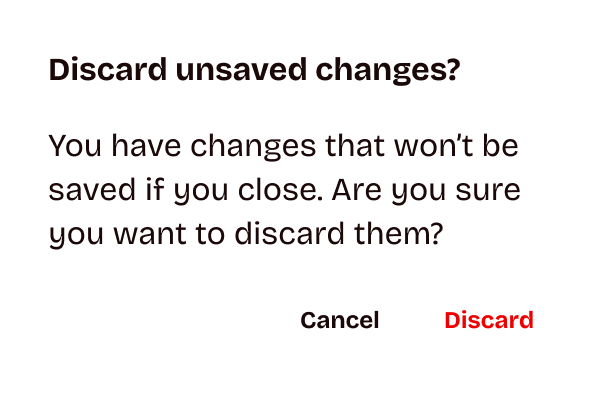 | `AsanAlertDialog` | `lib/widgets/communication.dart` | `title, content, cancelText, destructiveText, primaryAction` | Groceries, Meal Plan, Pantry, Recipe Form, Settings |
| 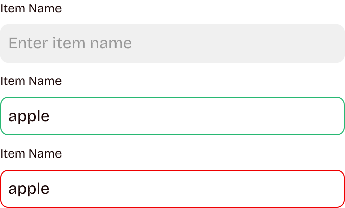 | `AsanTextField` | `lib/widgets/inputs.dart` | `label (required), hintText, controller, onChanged, keyboardType, autofillHints, obscureText, hasError, errorText, required, expandsWithContent, labelAction, horizontalPadding, labelStyle` | Groceries, Meal Plan, Pantry, Recipe Form, Settings |
| 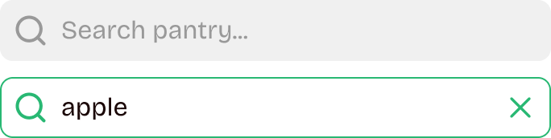 | `AsanSearchBar` | `lib/widgets/inputs.dart` | `hintText (required), onChanged, initialQuery` | Groceries, Pantry, Recipes, Search, dropdown lists |
| 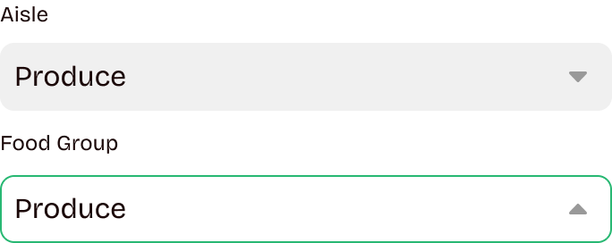 | `AsanDropdownMenu` | `lib/widgets/inputs.dart` | `label, items (required), value, hintText, searchHint, onChanged, hasError, errorText, required, labelColor, showLabel` | Groceries, Meal Plan, Pantry, Recipe Form, Settings |
|  | `AsanAppBar` | `lib/widgets/navigations.dart` | `screenTitle (required), icon, onIconPressed, actionRightPadding, bottom, forceElevated, backgroundColor, foregroundColor` | Groceries, Meal Plan, Pantry, Recipes, Settings |
|  | `FullScreenDialogHeader` | `lib/widgets/navigations.dart` | `screenTitle (required), onBackPressed, trailing, bottomPadding` | Groceries, Meal Plan, Pantry, Recipe Form, Settings |
| 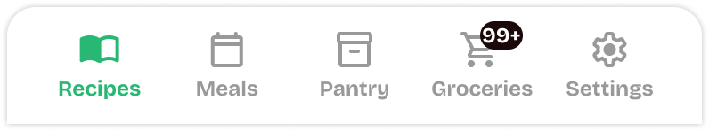 | `AsanNavigationBar` | `lib/widgets/navigations.dart` | `selectedIndex (required), onDestinationSelected (required), groceriesBadgeCount` | Main app shell |
|  | `AsanExpansionTile` | `lib/widgets/containment.dart` | `title, titleWidget, itemCount, children, initiallyExpanded` | Groceries, Pantry |
| 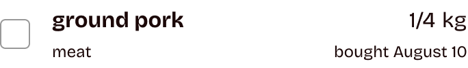 | `AsanListTile` | `lib/widgets/containment.dart` | `itemName (required), amount (required), unit (required), category (required), purchasedDate (required), notes, onTap, isChecked, onChanged` | Groceries, Pantry |
| 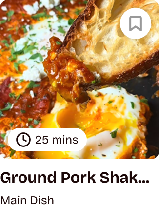 | `RecipeCard` | `lib/widgets/containment.dart` | `recipeName (required), mealCategory (required), totalTime (required), imageUrl, imageBytes, isSaved, showBookmark, onIconPressed, onTap, onViewPressed` | Recipes, Search |
| 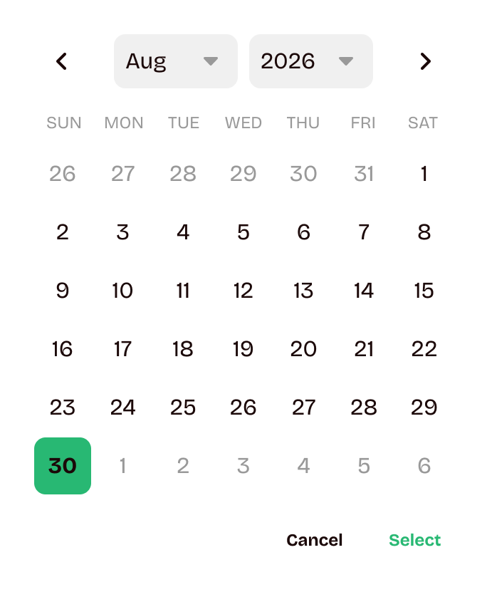 | `AsanDatePicker` | `lib/widgets/selections.dart` | `variant, initialDate, firstDate, lastDate, onDateSelected, onCancel, selectedDates, onDateToggled` | Meal Plan, Pantry (through `AsanDateField`) |
| 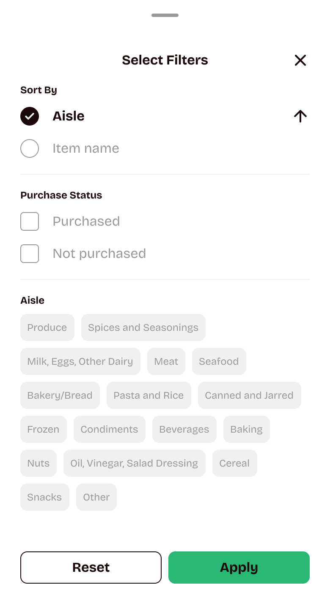 | `AsanFilterList` | `lib/widgets/selections.dart` | `menuType (required), scrollController, initialSelection, showDaySort` | Groceries, Meal Plan, Pantry, Recipes, Search |
| 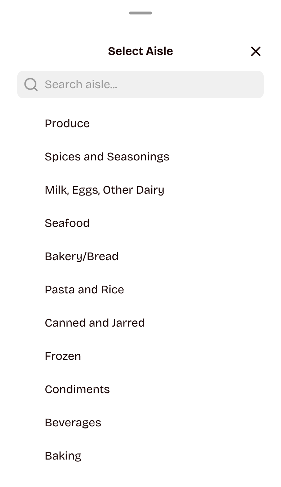 | `AsanDropdownList` | `lib/widgets/inputs.dart` | `title (required), items (required), selectedValue, searchHint, showSearch, scrollController` | Groceries, Meal Plan, Pantry, Recipe Form, Settings (through `AsanDropdownMenu` and `AsanDatePicker`) |

Other reusable widgets without a separate image include `AsanSwipeableActions`, `MealCard`, `AsanSearchCard`, `AsanTag`, `AsanDivider`, `AsanImagePicker`, `AsanDateField`, `AsanStepProgress`, `AsanEmptyState`, and `AsanSnackBar`.

## Changes since the last version

| Element | Last Version | Changes | Why it changed |
| --- | --- | --- | --- |
| Palette | Primary `#49BC58`, background `#F9FEF9`, accent `#FD883F` | Primary `#28B873`; text/secondary `#1B0808`; `onSecondary` `#FFFFFF`; surface `#FFFFFF` with container gray `#F0F0F0`; error `#EE0000`; and meal-time tag accents `#F4E285`, `#FF99C8`, `#A9DEF9`, `#FF8552`, `#E4C1F9` | The palette was revised to a more minimalist, modern system. Five accent colors were added as meal-time tags so meals are distinguishable at a glance in the weekly meal plan. |
| Spacing | Tight spacing between related items: 8 px | 4 px base unit; 4 px inside a list row; 8 px between list rows; 16 px section gaps; 24 px screen-edge insets | One tight tier did not provide enough control for list-row layouts. M7A3 uses 4 px within a row and keeps 8 px between rows. |
| Components | Five described components: AppBar, BottomNavigationBar, SearchBar, FloatingActionButton, and ItemCard | 26 component entries with constructor parameters, plus 10 additional reusable widgets listed below | Building the M7A2 mockup screens surfaced components the initial inventory missed, including icon-button variants, text/filled/outlined buttons, badges, chips, dialogs, and sheets. The expanded inventory reflects reusable widgets currently implemented in `lib/widgets/`. |
